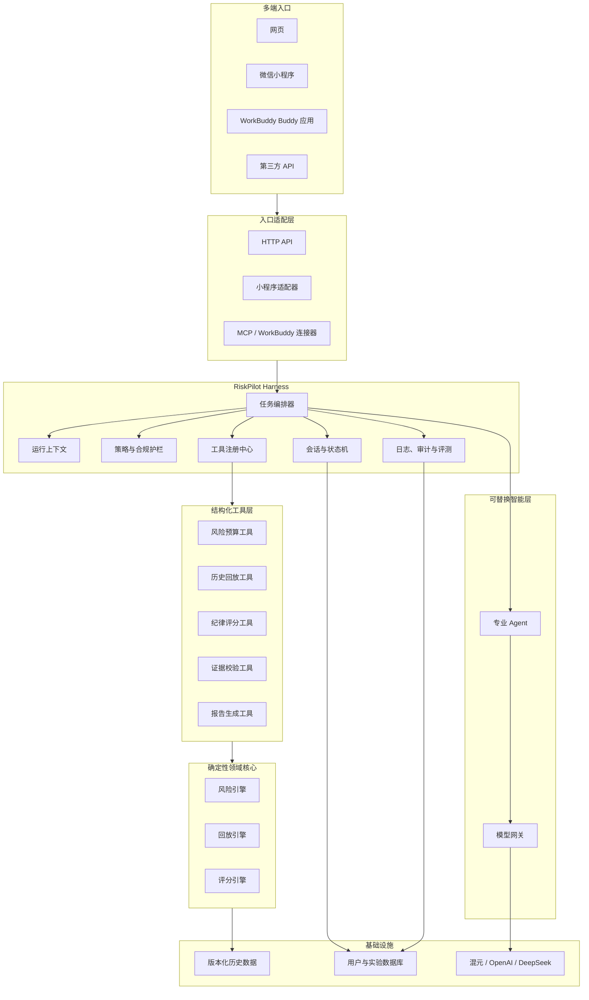
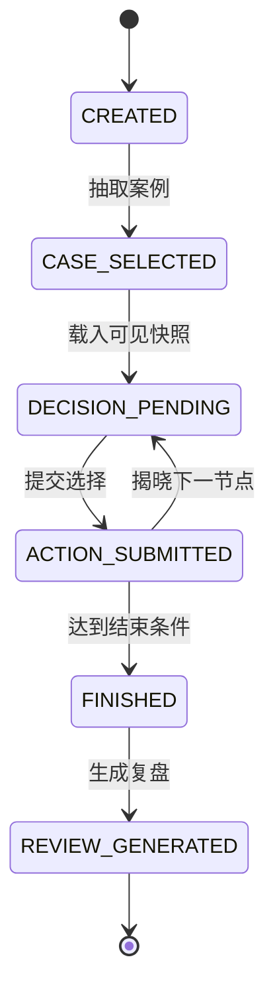

# RiskPilot V2 Harness 架构说明

## 1. 文档目的

本文定义 RiskPilot V2 的目标架构、模块边界和关键约束。V2 的目标不是增加更多 Agent，而是把 V1 已验证的风险计算、历史回放和纪律评分能力封装成稳定、可审计、可复用的工具，使网页、微信小程序和 WorkBuddy 可以共享同一套业务核心。

本文描述目标状态，不代表当前代码已经全部完成。

## 2. 核心设计原则

1. **确定性计算优先**：本金、损失预算、仓位、费用、账户状态、最大回撤和纪律评分必须由版本化规则计算。
2. **AI 只做解释与编排**：模型可以整理证据、解释结果和生成复盘，不得修改确定性计算结果。
3. **时间边界不可绕过**：历史实验中的任何工具和 Agent 只能读取当前决策节点及以前的数据。
4. **工具契约稳定**：每个工具必须有明确的输入、输出、错误、权限、版本和副作用说明。
5. **入口与核心解耦**：网页、小程序、WorkBuddy 和第三方 API 不复制业务规则，只调用 Harness。
6. **模型可替换**：混元、OpenAI、DeepSeek 或离线预设模式通过统一模型网关接入。
7. **全过程可追溯**：关键调用记录用户、场景、工具版本、规则版本、数据快照和结果摘要。
8. **渐进迁移**：V2 建设期间保持 V1 可运行，每次只迁移一个能力，并用一致性测试验证。

## 3. 目标架构



## 4. 各层职责

### 4.1 入口适配层

负责协议转换和身份接入，不包含风险业务规则。

- 网页通过 HTTP API 调用。
- 微信小程序通过 HTTPS API 和微信登录身份调用。
- WorkBuddy 通过 MCP、连接器或 Buddy 应用调用。
- 第三方集成通过受控 Public API 调用。

### 4.2 Harness 编排层

Harness 是 V2 的核心外壳，负责决定“谁可以在什么上下文中以什么顺序调用哪些工具”。

- `RuntimeContext`：用户、入口、产品场景、实验编号、当前时间点和权限。
- `Orchestrator`：执行工作流，组合工具和 Agent，不承担领域计算。
- `ToolRegistry`：注册工具定义，校验参数并统一返回格式。
- `PolicyGuard`：在调用前后执行数据边界、合规和权限检查。
- `SessionState`：保存挑战进度，控制状态转换。
- `AuditRecorder`：记录输入摘要、输出摘要、版本和异常。

### 4.3 工具层

工具层为上层提供稳定、结构化、可测试的能力。首批工具建议包括：

| 工具 | 类型 | 作用 | 是否改变状态 |
|---|---|---|---|
| `draw_history_case` | 回放 | 按规则抽取历史案例 | 是 |
| `get_visible_snapshot` | 证据 | 获取当前节点可见信息 | 否 |
| `calculate_risk_budget` | 风险 | 计算风险预算与仓位边界 | 否 |
| `preview_position` | 风险 | 预览模拟操作的损失情景 | 否 |
| `submit_replay_action` | 回放 | 提交一轮决策并推进状态 | 是 |
| `calculate_discipline_score` | 评分 | 计算纪律评分与违规项 | 否 |
| `build_risk_report` | 报告 | 汇总确定性结果和受证据约束的解释，并持久化 | 是 |
| `get_risk_report` | 报告 | 按用户读取已保存的完整报告 | 否 |
| `verify_report_integrity` | 报告 | 校验结构化报告和 Markdown 是否被修改 | 否 |
| `verify_evidence` | 证据 | 校验证据文件和哈希 | 否 |

每个工具至少返回：

```json
{
  "success": true,
  "data": {},
  "meta": {
    "tool_name": "calculate_risk_budget",
    "tool_version": "1.0.0",
    "rule_version": "risk-v1",
    "snapshot_id": "601318-2025-08-29",
    "trace_id": "generated-trace-id"
  },
  "warnings": []
}
```

### 4.4 领域核心

领域核心只负责纯业务计算，不依赖 FastAPI、网页、小程序、数据库或模型 SDK。

- 风险引擎：预算、仓位、费用、压力情景。
- 回放引擎：成交、现金、持仓、分红、账户轨迹。
- 评分引擎：预算执行、最大回撤、操作纪律和归一化评分。

相同输入、规则版本和数据快照必须产生相同结果。

### 4.5 智能层

智能层负责非确定性任务：

- 技术面、基本面和信息面解释；
- 复盘教练提问；
- 面向不同受众生成报告；
- 在 Harness 授权范围内选择只读工具。

智能层不得：

- 修改工具返回的关键数字；
- 读取未来数据；
- 绕过策略护栏；
- 直接写入排行榜或实验成绩；
- 输出收益承诺或实盘交易指令。

## 5. 历史挑战状态机



非法状态转换必须被拒绝。例如，未创建实验时不能提交操作，实验结束后不能再次修改成绩。

## 6. 产品场景策略

同一核心能力通过策略配置服务不同产品入口：

| 场景 | 目标用户 | 主要能力 | 主要限制 |
|---|---|---|---|
| `consumer_education` | 小程序公众用户 | 历史挑战、纪律复盘 | 不提供实时荐股和收益承诺 |
| `institution_training` | 金融机构员工 | 培训任务、审计、批量报告 | 企业身份、权限和数据隔离 |
| `portfolio_demo` | 项目展示访客 | 固定样本和离线分析 | 不保存敏感信息 |
| `research_sandbox` | 内部研发人员 | 模型与规则试验 | 与公开生产数据隔离 |

## 7. 数据与审计要求

每次关键计算至少关联：

- `user_id` 或匿名会话 ID；
- `experiment_id`；
- `scenario`；
- `as_of` 历史时间点；
- `snapshot_id` 和数据哈希；
- `tool_name`、`tool_version` 和 `rule_version`；
- 模型提供方、模型名称和提示词版本（若调用模型）；
- 调用结果摘要、警告和异常；
- 创建时间和持续时间。

日志不得直接保存 API Key、微信 AppSecret 或不必要的个人敏感信息。

## 8. 建议代码结构

```text
apps/
  api/
  web/
  wechat-miniapp/
  workbuddy/
src/riskpilot/
  domain/
  harness/
  tools/
  agents/
  policies/
  infrastructure/
tests/
  unit/
  integration/
  compliance/
  evals/
```

在迁移完成前，现有 `backend/`、`frontend/` 和 `tests/` 继续保留，保证 V1 可以运行。

## 9. 非目标

V2 Harness 首阶段不处理以下事项：

- 连接真实证券账户或自动下单；
- 实时荐股和收益预测；
- 在客户端保存模型密钥；
- 为不同入口分别复制风险规则；
- 一次性重写全部 V1 代码；
- 在没有数据授权结论前商业再分发第三方数据。

## 10. 架构验收标准

Harness 第一阶段完成时，应满足：

1. 风险计算可通过结构化工具独立调用。
2. 工具结果包含规则版本、数据快照和追踪编号。
3. 新旧风险计算在固定测试用例中结果一致。
4. 历史实验无法读取未来数据。
5. 更换模型不会改变确定性风险数字。
6. 网页和至少一个新入口可以调用同一工具契约。
7. 关键工具调用可以被审计和复现。

